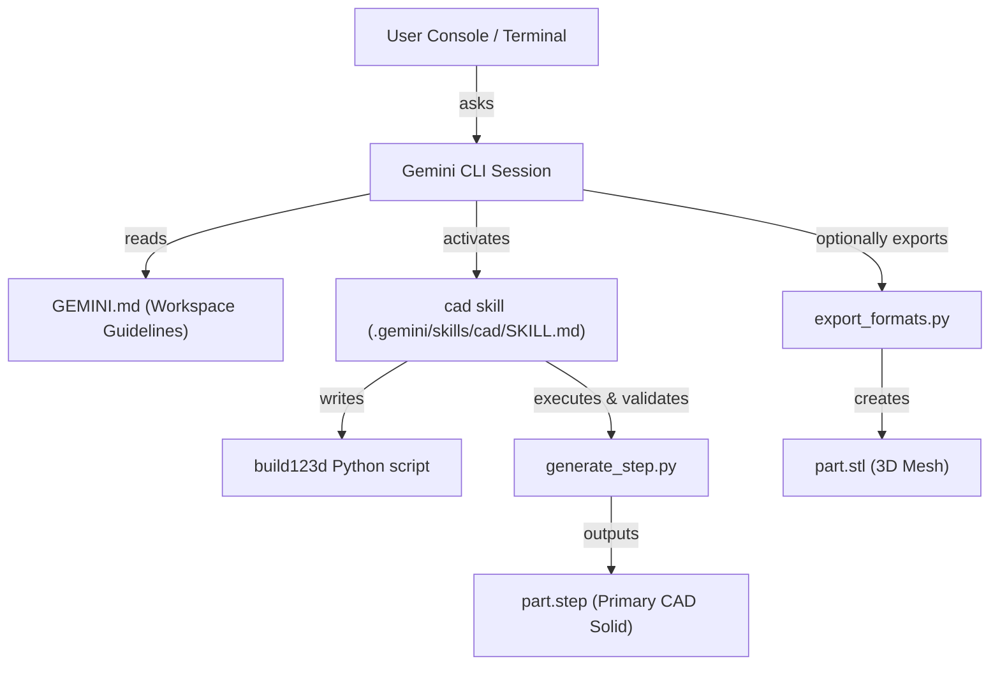

# AICAD — Text-to-CAD with Gemini CLI

Generate 3D CAD models from natural-language descriptions using `build123d` and your Gemini CLI agent.

> Adapted from [earthtojake/text-to-cad](https://github.com/earthtojake/text-to-cad)

---

## What it does

1. You ask the Gemini CLI agent to create a part ("make a mounting bracket for a 2020 extrusion").
2. The agent translates your prompt into `build123d` Python code.
3. The agent executes and validates the code to produce a **STEP file** (the primary CAD artifact).
4. Optionally, you can request exports to other formats like **STL**, **3MF**, or **DXF**.

---

## Architecture



---

## Setup

### Prerequisites

- **Python 3.13+**
- **[uv](https://docs.astral.sh/uv/)** package manager
- **Gemini CLI** (installed and configured globally)

### Install Dependencies

Clone this repository, then sync the base dependencies and build123d:

```bash
cd /Users/ginger/Developer/AICAD
uv sync

# Install CAD dependencies (requires ~1 GB disk space for OCP)
uv sync --extra cad
```

### Configuration

Gemini CLI automatically discovers:
1. **Workspace Guidelines**: Configured in [GEMINI.md](file:///Users/ginger/Developer/AICAD/GEMINI.md) in the project root.
2. **Project-Scoped Skills**: Discovered inside the [.gemini/skills/cad/](file:///Users/ginger/Developer/AICAD/.gemini/skills/cad/) directory.

No manual installation is needed; simply run Gemini CLI inside this workspace.

---

## Project Structure

```
AICAD/
├── GEMINI.md                       # Persistent workspace-wide instructions
├── pyproject.toml                  # Project settings and dependencies
├── .gemini/
│   └── skills/
│       └── cad/
│           ├── SKILL.md            # Skill instructions read by the agent
│           ├── requirements.txt    # Python dependencies for the CAD skill
│           ├── scripts/
│           │   ├── generate_step.py    # Subprocess runner & STEP validator
│           │   ├── inspect_step.py     # STEP file structure & dimensions inspector
│           │   └── export_formats.py   # Converter: STEP -> STL/3MF/DXF
│           └── references/
│               ├── natural-language-specs.md   # Guidelines for design briefs
│               ├── build123d-patterns.md      # build123d API patterns and rules
│               └── supported-exports.md       # Export formats specifications
```

---

## Usage

### Interactive Usage (Gemini CLI)

Simply start a Gemini CLI session in this workspace:

```bash
gemini
```

Then prompt your assistant:

> "Make an L-bracket, 50mm on each side, 3mm thick, with two M4 holes on each leg"

The agent will design the bracket, generate Python code, run it, and validate the resulting STEP file automatically.

### Web UI Usage (Recommended)

To run the pipeline interactively from your web browser, featuring a real-time progress tracker, interactive 3D WebGL viewer, and export downloader:

1. **Start the server** (already running in the background):
   ```bash
   uv run python server.py
   ```
2. **Open the browser**:
   Navigate to `http://localhost:8080` in your web browser.
3. **Submit prompts**:
   Enter your part description in the textarea (or click a suggestion) and click **Run CAD Agent**.
4. **Watch it compile**:
   The Antigravity IDE agent in this chat window will automatically wake up, generate the build123d code, build the STEP/STL models, render the snapshot, and return it. The Web UI will transition through the steps and display the completed 3D model!

---

### Standalone Command Line Usage

You can also run the utility scripts manually using `uv run`:

```bash
# Execute and validate a build123d script
uv run python .gemini/skills/cad/scripts/generate_step.py path/to/part.py

# Inspect geometry info of a STEP file
uv run python .gemini/skills/cad/scripts/inspect_step.py path/to/model.step

# Export STEP to STL mesh
uv run python .gemini/skills/cad/scripts/export_formats.py model.step --format stl
```

---

## Supported Formats

| Format | Geometry Representation | Primary Use Case |
| :--- | :--- | :--- |
| **STEP (`.step` / `.stp`)** | Exact Boundary Representation (B-rep) | CAD interchange, editing, CNC (Primary) |
| **STL (`.stl`)** | Triangulated mesh | 3D Printing, slicing (Secondary) |
| **3MF (`.3mf`)** | Modern compressed mesh | Multi-material/color 3D printing (Secondary) |
| **DXF (`.dxf`)** | 2D lines and curves | Laser cutting, sheet metal, CNC flat (Secondary) |

---

## License

This project is licensed under the MIT License.
